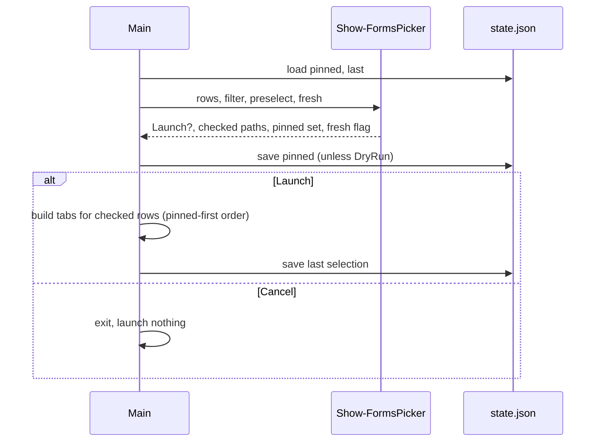
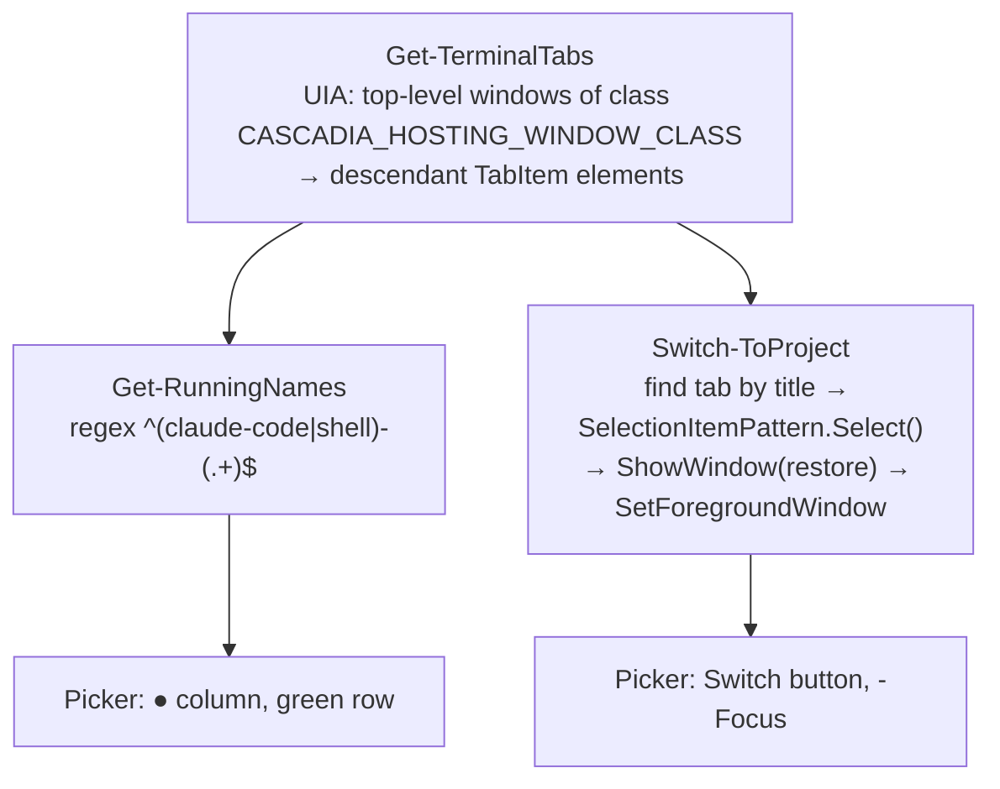

# Design: Interactive Picker

## Overview

`Show-FormsPicker` builds a WinForms dialog programmatically (no designer files). It returns `{ Launch, Paths, Pinned, Fresh }`; the caller persists state and builds tabs.



## UI layout

```
Filter: [____________]   hint
+-------------------------------------------------------------+
| [x] ★ project   when   timestamp   branch   state   path     |  ListView (Details, CheckBoxes, FullRowSelect)
+-------------------------------------------------------------+
[ ] Fresh sessions            [Pin / Unpin] [Launch] [Cancel]
```

Launch is the `AcceptButton` (Enter); Cancel is the `CancelButton` (Esc). The form is `TopMost` so it appears over other windows when started from the hidden-window shortcut.

## State handling inside the dialog

WinForms event handlers are scriptblocks bound with `.GetNewClosure()`. Closures copy local variables and cannot see `$script:` state of the calling script, so all mutable state lives in a single `$ctx` hashtable:

| `$ctx` member | Purpose |
|---|---|
| `Pinned` | `HashSet[string]` (case-insensitive) of pinned paths |
| `Checked` | `HashSet[string]` of checked paths; survives filter rebuilds |
| `Rebuilding` | Suppresses `ItemChecked` while the list is repopulated |

`$fill` rebuilds the list: pinned rows first, then the rest in recency order, applying the filter and re-applying checked state.

## Persistent picker and tab switching

Tab titles are unique (`cc:<project>`, `sh:<scope>`), so open workspaces are found by title rather than by index (`wt focus-tab -t N` breaks when tabs are closed or reordered, and only works within one window).



Notes from the spike:
- Reading tab titles and selecting a tab worked across multiple windows of one Windows Terminal process; `SetForegroundWindow` succeeded when called from a foreground process.
- A synthetic Alt key tap precedes `SetForegroundWindow` so it also succeeds when called from a script (`-Focus`).
- WinForms handlers are closures and cannot see script functions or `$script:` state, so launching, switching and running-detection are passed in as scriptblocks (`$OnLaunch`, `$OnSwitch`, `$GetRunning`) created in the main script.
- `Invoke-Launch` holds the tab-building and `wt` start logic and is called by the picker's Launch handler, `-Project`, `-All` and the Grid picker.

## Git columns

`Get-GitInfo` runs `git branch --show-current` and `git status --porcelain` (first line only) per repo. Skipped when `gitInfo: false` or when no picker is shown.

## Ordering

`Sort-Projects` (pinned first, then recency) is applied to the full list before display and again to the chosen set before launch, so tab order matches what the user saw.
