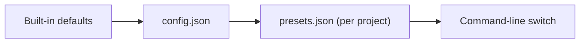
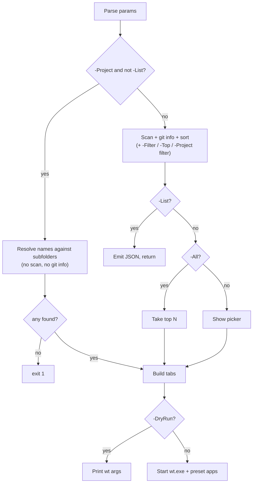

# Design: Configuration, Presets and Agent Mode

## Precedence



Lowest to highest. Parameters use `$PSBoundParameters.ContainsKey` to distinguish "not given" from "given as default". Switch-style overrides are one-directional (`-NoShell`, `-NoDiff`, `-NoColor`, `-Fresh` can only turn things off / force fresh).

Effective values for a project:

| Setting | Resolution |
|---|---|
| shell tab | `preset.shell` if set, else `config.shell`; `-NoShell` always disables |
| diff | same pattern with `-NoDiff` |
| claude args | `preset.claudeArgs` if set (even empty), else `config.claudeArgs` |
| tab color | `preset.tabColor`, else hash color if `config.tabColors` and not `-NoColor` |

## Files

| File | Committed | Written by |
|---|---|---|
| `config.json` | yes | human |
| `presets.example.json` | yes | human (template) |
| `presets.json` | no | human |
| `state.json` | no | script (`last`) |

## Agent-mode flow



The `-Project` fast path avoids the activity scan, so an agent that already knows the names gets an immediate launch.

## JSON contract for `-List`

```json
[
  {
    "name": "api-server",
    "path": "C:\\code\\api-server",
    "lastActive": "2026-11-22T20:51:50.0000000-05:00",
    "isGit": true,
    "branch": "main",
    "dirty": true,
    "running": false,
    "remoteUrl": "https://github.com/owner/repo",
    "hasClaudeHistory": true,
    "hasPreset": false
  }
]
```

`branch` and `dirty` are `null` for non-git folders or when `gitInfo` is false. The output is always an array, even for one project.

## Notes

- `-Project` values arrive as one string under `powershell -File`, so each is split on commas.
- The `-All` cap (15 default) guards against opening dozens of tabs by accident.
- `claudeArgs` cannot contain double quotes (they would break `wt` quoting).

