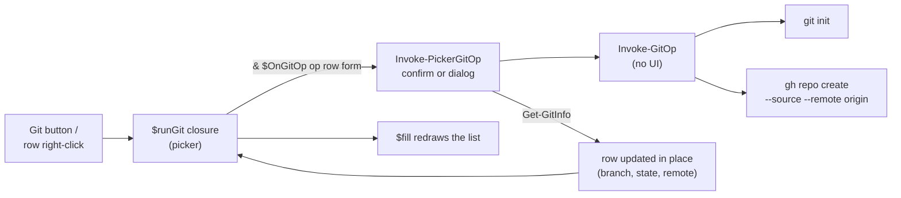

# Design: Git actions

## Overview

Two layers, following the picker's callback pattern (WinForms handlers are closures and can't call script functions):

- `Invoke-GitOp $Op $Dir $Opts` is the non-UI core (`init`, `remote`) returning `{ Ok, Message }`. It honors `-DryRun`. A later agent-mode switch can call it directly.
- `Invoke-PickerGitOp` asks first (`MessageBox` for init, `Show-NewRemoteDialog` for remote), calls the core, then refreshes the shared row object with `Get-GitInfo`, so the list and the Remote link update without a rescan.
- `Get-GitHubOwners` fills the owner list from `gh api user` and `gh api user/orgs`; on any failure the list is empty and the owner box is still typeable.
- Menu enablement is decided in the menu's `Opening` event from the highlighted row: Open needs `RemoteUrl`, Initialize needs no `.git`, Create needs no `RemoteUrl`.

## Config

| Key | Default | Use |
|---|---|---|
| `gitOpsOrg` | `""` | Owner pre-filled in the Create dialog |
| `gitOpsVisibility` | `private` | Visibility pre-selected in the Create dialog |

## Layout

The form widened by one button (1260 px) so **Git** sits between Settings and Arrange.

## Out of scope (for now)

- Hosts other than GitHub, and other version control systems (issue #2).
- Agent-mode flags for these actions.
