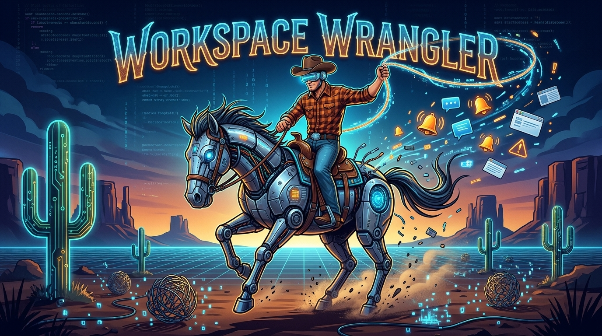
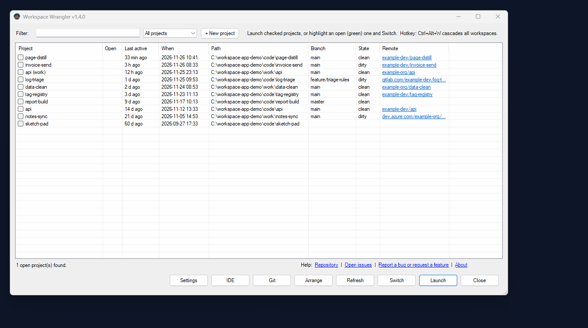
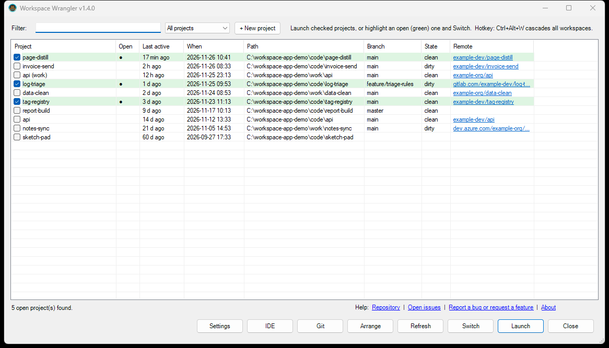
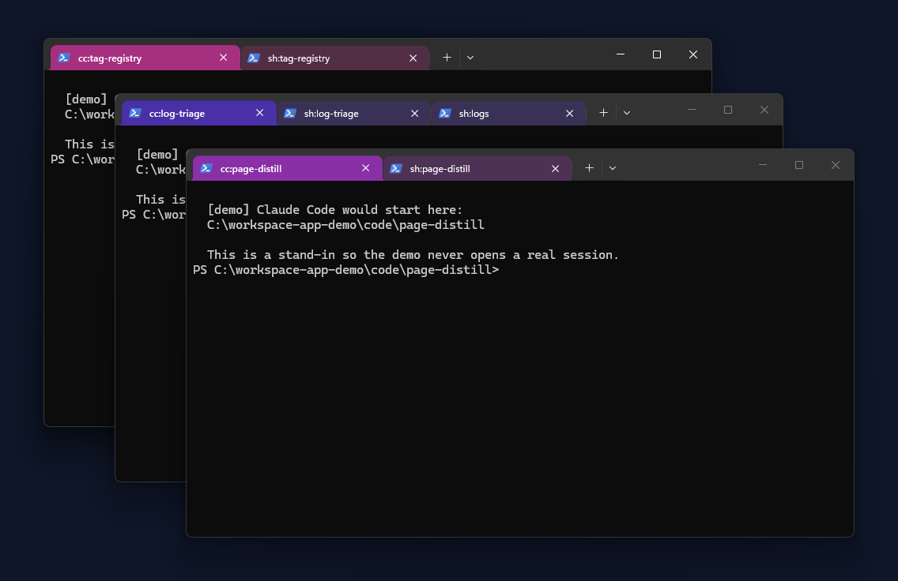
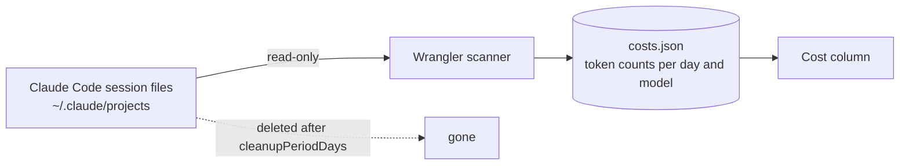

<p align="center"></p>

# Workspace Wrangler

> Windows only (Windows Terminal, PowerShell 5.1 and Claude Code). Issues and ideas welcome.

**Tame your sea of projects and terminals, and restart your whole workday in one click.**

A small picker that lists your project folders (newest activity first) and opens each one as its own [Windows Terminal](https://aka.ms/terminal) window: a [Claude Code](https://claude.com/claude-code) session that resumes your last conversation, plus a shell tab with `git status`, already in the right folder and color-coded.

- **Start the day in one click:** yesterday's selection is pre-checked; press **Launch**.
- **Always know what's open:** the picker marks projects that already have tabs open; **Switch** jumps to the right window, **Launch** never duplicates one.
- **See where things stand:** last activity, branch, dirty/clean and a link to each repo's remote.
- **Do the chores:** open projects in your IDE, create repositories on GitHub / GitLab / Azure DevOps, cascade all windows with a hotkey.

## Take a look







More in the [tour](docs/tour.md). To try it without pointing it at your own projects, run `.\tools\New-DemoWorkspace.ps1 -Launch`: it builds a throwaway workspace of fake projects with its own settings, and removes cleanly with `-Remove`.

## Install

**Requirements:** Windows 10/11, [Windows Terminal](https://aka.ms/terminal), the built-in Windows PowerShell 5.1, [Claude Code](https://claude.com/claude-code) (`claude` on PATH), [Git](https://git-scm.com/download/win) and [Visual Studio Code](https://code.visualstudio.com/). The installer checks for Git and VS Code and stops with instructions if either is missing. Optional: `gh` / `glab` / `az` only for creating remote repositories.

1. Download **Source code (zip)** from the [latest release](https://github.com/dstaulcu/workspace-wrangler/releases/latest) and extract it somewhere permanent (for example `C:\tools\workspace-wrangler`). Or clone: `git clone https://github.com/dstaulcu/workspace-wrangler.git`.
2. In that folder, run:
   ```powershell
   powershell.exe -NoProfile -ExecutionPolicy Bypass -File .\Install-Shortcut.ps1
   ```
   This puts one **Workspace Wrangler** shortcut on your Desktop.
3. Double-click **Workspace Wrangler**. Each subfolder of your projects folder is a project (you can use several folders; they merge into one list). The first time, the picker asks where your projects live: it suggests the folders your tools already use (where you opened projects in Claude Code or VS Code, found by reading their local history files; nothing is sent anywhere) and common ones such as `~\source\repos` or `~\src`, or you can **Browse...** to any folder, and it remembers the answer. Change them later under **Settings > Projects folders...**.

To try it without installing: `powershell.exe -NoProfile -ExecutionPolicy Bypass -File .\Start-App.ps1`.
**Update:** the picker offers new releases itself (see below). **Uninstall:** `.\Uninstall-App.ps1` (add `-WhatIf` to preview, `-RemoveSettings` to also delete settings).

## Using the picker

Select projects by ticking their boxes, or by Ctrl-clicking and Shift-clicking rows (Ctrl+A selects everything shown): ticking and highlighting are the same selection, and it stays selected while you filter. Then press **Launch** (or Enter). Type in the filter box to narrow the list by name, path or branch, use the dropdown beside it to show only dirty, clean, open, not-open or non-git projects, and click a column header to sort.

| Button | What it does |
|---|---|
| **Launch** | Open the selected projects, one window each. Already-open projects are raised instead; **Shift** forces a new copy. |
| **Switch** | Bring the selected project's open tab and window to the front (the first one if several are selected). |
| **Refresh** | Re-detect open projects, re-read each project's git state and last activity, and pick up project folders you created or deleted since the picker started (the open-project check also runs automatically every `refreshSeconds`). Folders are not rescanned when the list was narrowed with `-Filter`, `-Top` or `-Project`. |
| **Arrange** | Cascade, grid, side by side, stacked, reset size. **Shift** ignores saved spots. |
| **Git** | Open the repo in a browser, `git init`, create a remote (GitHub / GitLab / Azure DevOps submenus), add an existing remote URL, **push the current branch to origin** (asks first; a plain push, never forced), or rename a local `master` to `main`. Also on the right-click menu. |
| **IDE** | Open every selected project in your IDE, one window each (`ide`, default `code`). |
| **Settings** | Edit `config.json` / `presets.json`, save window layout, check for updates, open the changelog. |

**Right-click a project** for finer control: **Launch** (Claude + shell, Claude only, shell only, a **Claude session** choice of continue / pick one to resume with `--resume` / fresh, or a new window even if already open), **Switch** (to its Claude tab or its shell tab), **IDE** (open in your IDE, open the folder in File Explorer, copy the path), **Git**, **Launch options...** and **Rename project...**. Launch, Switch and IDE act on the highlighted projects; Git, Launch options and Rename act on the first one. **Launch options...** edits that project's entry in `presets.json` without hand-editing JSON: its Claude arguments, whether it gets a shell tab and git summary, a **startup command** for the shell tab (such as `npm run dev`), **URLs** to open in your browser each time it launches, and its tab color. Extra tabs and extra applications stay in `presets.json` (a button in the dialog opens it). Add your own Claude variants (for example plan mode) with `claudeVariants` in `config.json`.

The **+ New project** button beside the filter box (or a right-click in empty space) creates a folder in your projects folder, optionally runs `git init`, adds a README and opens it in your IDE, then reloads the list with it pre-checked. **Rename project** renames the folder and carries along its Claude conversation history (so `--continue` keeps working), its `presets.json` entry, its saved window position and the remembered selection; close its terminal tabs first, because Windows cannot rename a folder that is in use. The dialog also offers a message for Claude (editable, on by default): on the next launch of that project it is sent once as Claude's first message ("I just renamed this project's folder from X to Y. Please update any artifacts that refer to the old name or path..."), so references to the old name get fixed.

For a fresh Claude conversation use right-click > **Launch > Claude session**, or `-Fresh` from the command line. The picker stays open after launching, so you can keep launching and switching. Tabs are titled `cc:<project>` and `sh:<scope>`; that is how open projects are found, so don't rename them.

**Hotkey:** while the picker is open (it can be minimized), **Ctrl+Alt+W** finds all open workspaces, restores minimized ones and cascades them, and parks the Wrangler itself beside the cascade (top aligned with the first window, just right of the last one; against the screen's right edge if there is no room) so it never gets buried behind them. The hotkey is also shown in the picker (hint line, Arrange tooltip and menu). Change it with `hotkey` in `config.json` (empty turns it off); the picker says so in the status bar if another program already owns the key. Without the picker: `Start-WorkspaceWrangler.ps1 -Cascade`.

**Window layout:** new windows are cascaded (`arrangeStyle`: `cascade`, `grid`, `columns`, `rows`). **Settings > Save window layout** remembers where each open project's window is, per monitor setup, and later launches put them back.

## Branch names (main, not master)

- **New repositories start on `main`.** The Git menu's init, **+ New project** and **Create remote repository** use `git init -b main` (set `defaultBranch` in `config.json` to change it; your own git `init.defaultBranch` wins).
- **Renaming is local-only.** **Git > Rename branch to main...** works only when there is no `origin`, or `origin` has no branches yet. If `origin` already has branches it changes nothing, because the host owns the default branch, pull request targets and branch protection.
- **Renaming on the host is yours to do**, on the host, then sync this clone:

  ```
  # GitHub: Settings > Branches > rename "master" to "main" (this retargets open pull requests), then here:
  git fetch origin --prune
  git branch -m master main
  git branch -u origin/main main
  git remote set-head origin -a
  ```
- **A cue when the two sides disagree.** If this clone is on `main` but remembers origin's default as `master` (or the reverse), the Branch cell turns orange and its hover explains which command fixes it. It reads a local ref only, so it costs no network call.
- **Creating a remote from a `master` branch** warns that `master` becomes the host's default branch.

## Project cost (optional)

The first time you start the picker it asks whether to show what each project has cost. If you say yes, a **Cost** column appears with each project's estimated API-equivalent Claude Code cost; hover a value for sessions, the last 7 and 30 days and the cost by model. It is computed from the session files Claude Code keeps under `~\.claude\projects` (read-only, local, nothing is sent; subagents included). The Wrangler keeps only token counts and model names in its own `costs.json`, so totals survive Claude Code deleting old sessions. Prices are list prices from `assets/model-prices.json` (add or change models in `~\.config\workspace_app\model-prices.json`); a `~` before an amount means some models are not in the table yet. It is an estimate of what the tokens would cost at API prices, not what a subscription plan bills. Turn it on or off under **Settings > Show project cost**.



The ledger is a small aggregate, so the raw files are only needed until they have been scanned once. [How it works, what is kept and dropped, and what that means for retention](docs/data-flow.md).

**Settings > Claude Code data health...** shows how long Claude Code keeps its session history (default 30 days, then it deletes them) and whether telemetry is on (names only, never endpoints). It explains what each retention length means for cost, resuming old sessions and any future usage review (see the [data flow](docs/data-flow.md)), and, only after you confirm and with a `settings.json.bak` backup, can set that one key. It never changes telemetry.

## Updates

On startup the picker checks GitHub **releases** (at most daily, without slowing startup; nothing happens until a release is published). When a newer one exists you can click **What's new**, **Update now** (in place, with backup and rollback; settings are kept) or **Skip this version**. After an update it offers to open the [changelog](CHANGELOG.md), which is also under **Settings > Changelog**. Turn the check off with `checkForUpdates: false`.

## Command line

Handy for per-project shortcuts and quick checks (no picker; open projects are focused instead of launched again):

```powershell
$s = '.\Start-App.ps1'
powershell.exe -NoProfile -File $s -Project a,b          # launch these projects
powershell.exe -NoProfile -File $s -Project a,b -DryRun  # print the wt command instead
powershell.exe -NoProfile -File $s -Focus a              # raise a's open tab
powershell.exe -NoProfile -File $s -Cascade              # cascade all open workspaces
powershell.exe -NoProfile -File $s -List                 # projects as JSON
```

Also: `-All -Top N`, `-Root`, `-Filter`, `-Fresh`, `-NoShell`, `-NoDiff`, `-NoColor`, `-Picker Grid`, `-Window <id>`, `-CheckUpdate`.

## Configuration

Settings live outside the repo in `~\.config\workspace_app\` (`config.json` global defaults, `presets.json` per-project tabs and arguments, `state.json` and `layouts.json` written for you), so updates never touch them. Precedence: command-line switch > per-project preset > `config.json`. Full reference with every key: **[docs/configuration.md](docs/configuration.md)**; JSON schemas give editors hover help.

## Safety

Launching never modifies your projects; the app writes only its own files in the settings folder. The only network calls are the update check (one read of the public releases list) and the Git actions you confirm (create remote, push). The **Git** menu, **New project** and **Rename project** are the only things that change your files, and only after you confirm; it uses your existing `gh` / `glab` / `az` sign-in and never sees a token.

## More

- Ideas: macOS/Linux terminals, other agent CLIs, saved sets of projects, a test suite.
- [MIT license](LICENSE)
