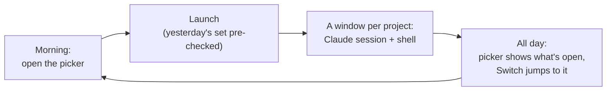
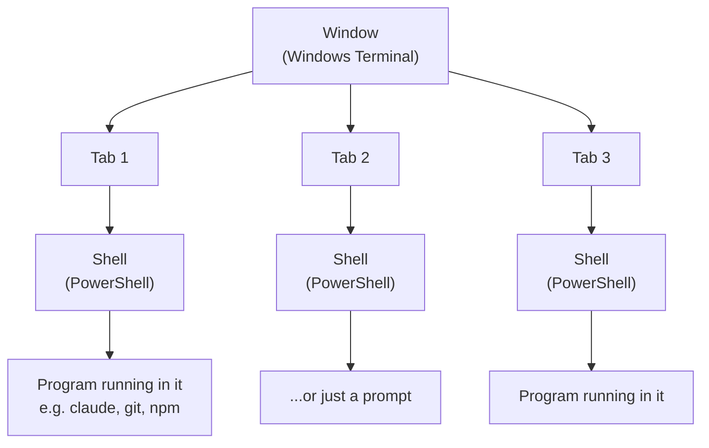
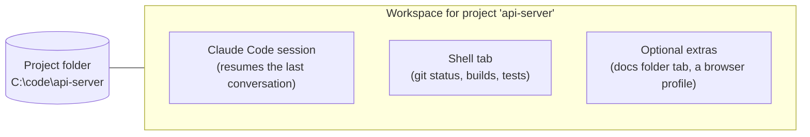
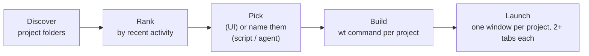
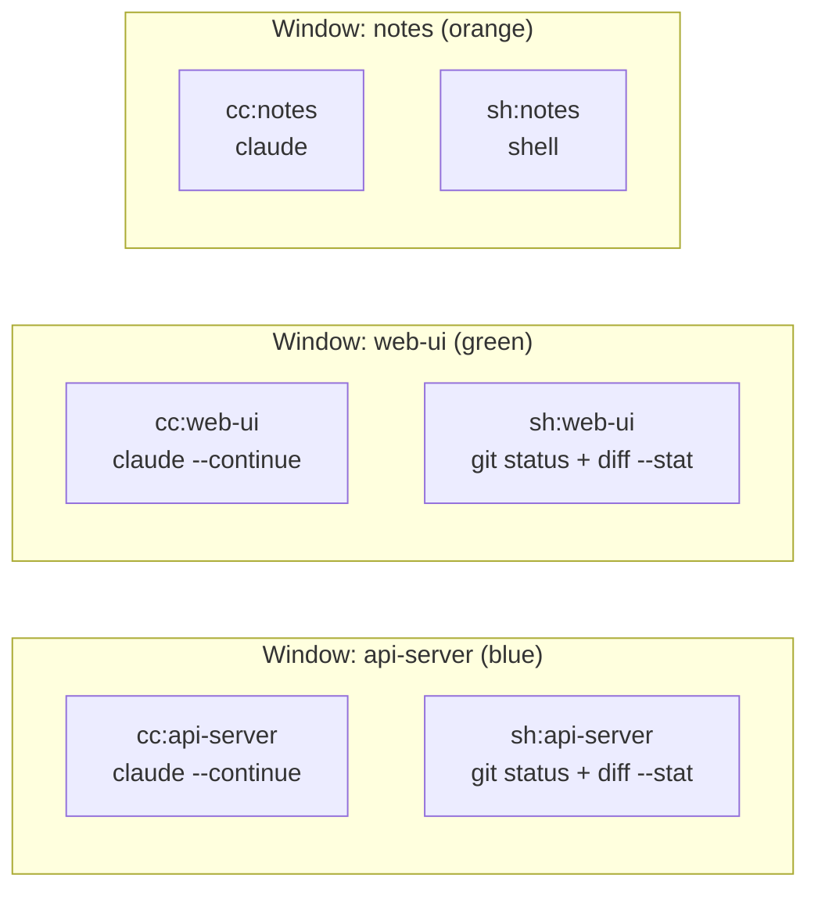
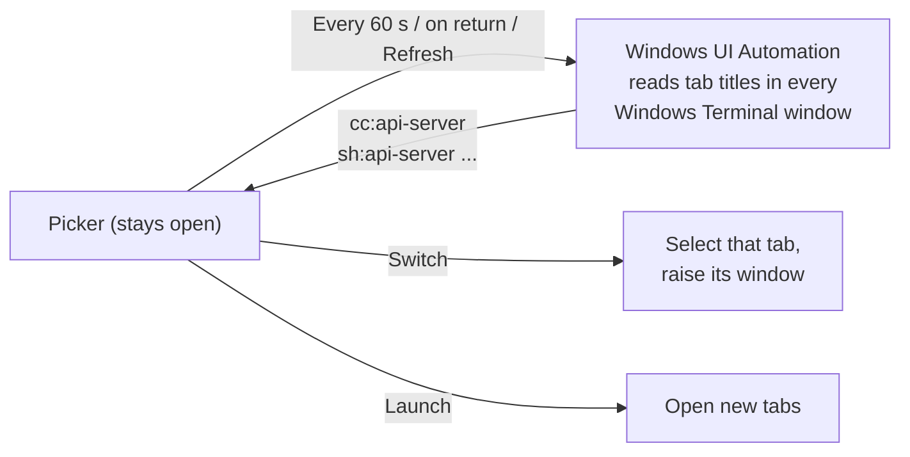
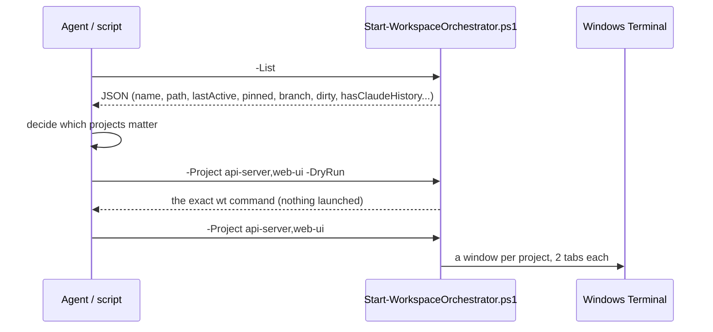
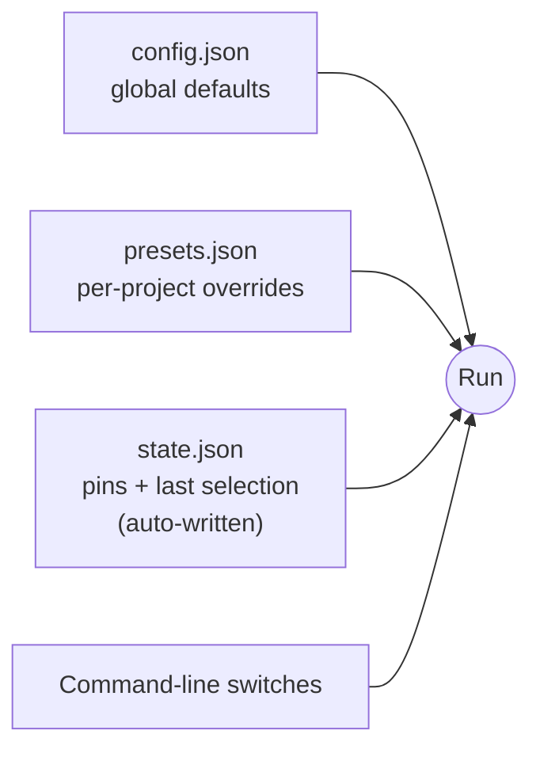

# Workspace Orchestrator

> **Status: experimental (v0.3).** Windows only. Works on my machine; expect rough edges. Issues and ideas welcome.

**Tame your sea of projects and terminals, and restart your whole workday in one click.**

If you work across a dozen repos, you know the drill: dozens of terminal windows, no idea which one is the API and which is the docs, and every morning the same ritual of opening a terminal, `cd`-ing into a project, running `claude --continue`, opening a second tab for `git status`... times every project. Workspace Orchestrator is a small picker that does that for you.

- **Start the day in one click.** Your projects are listed newest-activity first, and yesterday's selection is pre-checked. Press **Launch** and each project opens in its own [Windows Terminal](https://aka.ms/terminal) window: a [Claude Code](https://claude.com/claude-code) session that resumes the last conversation, plus a shell tab showing `git status` and a diff summary, already in the right folder and color-coded.
- **Always know what's open.** Leave the picker running. It watches your terminals (refreshing every 60 seconds by default), marks every project that already has tabs open, and **Switch** jumps straight to the right tab in the right window, however buried it is. Launching a project that's already open just brings it to the front instead of duplicating it.
- **See where everything stands.** Last activity, branch, dirty/clean state and a clickable link to each repo's remote (GitHub, GitLab, anything) in one list. Pin the projects you always want at the top.
- **Make it yours.** Per-project extra tabs, apps and Claude arguments; settings live in `~\.config\workspace_picker\` and are one **Settings** click away. AI agents and scripts can drive it too (agent mode).



---

## Concepts

### Terminals

Four words that get mixed up:



- **Terminal (emulator):** the app that draws text and takes keystrokes. Here, Windows Terminal (`wt.exe`).
- **Tab:** one independent session inside a terminal window.
- **Shell:** the command interpreter inside a tab (PowerShell here). It has a **current directory**, which is what makes "which project am I in?" a real thing.
- **Program:** whatever the shell is running, such as Claude Code.

### Workspaces

A **workspace** is everything you need open to work on one thing. For a software project that is typically:



Building one by hand means: open a terminal, `cd`, run `claude --continue`, open a second tab, `cd` again, run `git status`. Times the number of projects. Every day.

### Workspace orchestration

**Orchestration** is automating that setup: *decide which projects matter, then assemble all their workspaces in one go.*



What you get after picking, say, three projects (one window each):



---

## What's in it for you

| You want to... | Use |
|---|---|
| Start the day with your active repos open | Double-click the **Workspace Picker** desktop shortcut, then **Launch** |
| See what you touched last | Picker sorts by last git commit (or newest file) |
| Keep favorites at the top | **Pin** in the picker |
| Re-open yesterday's set | Last selection is pre-checked |
| Find an already-open workspace among many terminal windows | Keep the picker open; **Switch** raises the right tab and window. It rechecks every 60 s (`refreshSeconds`) |
| Avoid opening a project twice | Launch on an open project just raises it (Shift+Launch forces a new copy) |
| Jump from a project to its remote repo | Click the **Remote** column (owner/repo on GitHub, host/path elsewhere) in the picker |
| Know at a glance which repo has uncommitted work | Branch + dirty/clean columns; shell tab shows `git status` and a diff summary on open |
| Tell projects apart in the tab strip | Stable per-project tab colors |
| Resume a Claude conversation automatically | `--continue` is used only when a prior session exists |
| Add project-specific tabs/apps | `presets.json` (the picker's **Settings** button) |
| Let an AI agent or a script open workspaces | **Agent mode** (below) |

---

## Requirements

- Windows 10/11 with **Windows Terminal** (`wt.exe`)
- **Windows PowerShell 5.1** (`powershell.exe`, built in)
- [Claude Code](https://claude.com/claude-code) CLI on your `PATH` (`claude`)
- `git` (optional; enables commit-time ranking, branch/dirty info, and the diff summary)

## Quick start

```powershell
git clone https://github.com/dstaulcu/workspace-orchestrator.git
cd workspace-orchestrator

# 1. Try it
powershell.exe -NoProfile -ExecutionPolicy Bypass -File .\Start-WorkspaceOrchestrator.ps1

# 2. Optionally create a Desktop shortcut called "Workspace Picker"
powershell.exe -NoProfile -ExecutionPolicy Bypass -File .\Install-Shortcut.ps1
```

By default it treats each immediate subfolder of `C:\code` as a project. Change `root` in `config.json` (or pass `-Root D:\src`).

## Using the picker

Check the projects you want, press **Launch** (or Enter). Type in the filter box to narrow the list. Select a row and click **Pin / Unpin** to keep it at the top. **Fresh sessions** starts plain `claude` instead of `claude --continue`. If a checked project is already open in a terminal, Launch brings its window to the front instead of opening a second copy (hold **Shift** while clicking Launch to open a new one anyway). Close launches nothing.

### Arrange your windows

Launch 2 or more projects and their windows are **cascaded** on your primary screen instead of piling up exactly on top of each other: overlapping, each offset so every title bar stays visible (`arrangeOnLaunch`, `arrangeStyle`). Prefer something else? Set `arrangeStyle` to `grid`, `columns` (side by side) or `rows` (stacked).

Click **Arrange** in the picker at any time to tidy the windows that are already open. Pick a style from its menu: **Cascade**, **Tile in a grid**, **Side by side**, **Stacked**, **Reset window size** (default size, windows stay where they are) or **Restore saved layout only**. Cascade and Reset use a comfortable default size (`windowWidth` x `windowHeight`, 1100 x 750 pixels) instead of stretching windows across a wide monitor; only grid, columns and rows fill their cells. Hold **Shift** while choosing to ignore saved spots.

By default windows start at **desktop-icon row 2, column 2** (`keepDesktopIconsClear`), so the first column and row of your desktop shortcuts stay visible; set it to `false` to use the whole screen.

Want exact positions? Arrange the windows how you like, then use **Settings > Save window layout**. The next time you launch those projects (`restoreLayouts`) each one reopens in its saved spot, and the rest are arranged with your chosen style. Layouts are stored in `layouts.json`, keyed by your monitor setup, so a laptop-only day and a docked day don't fight each other.

### Stay open and jump between workspaces

The picker stays open after launching and quietly rechecks your terminals every `refreshSeconds` (60 by default; `0` turns it off), redrawing only when something changed (untick **Keep open after launch**, or set `keepOpen: false`, for the old close-on-launch behavior). Projects that already have tabs open in any Windows Terminal window show a ● and a green row. Highlight one and click **Switch** to select its tab and bring its window to the front. That's the answer to "I have a sea of terminals and can't find the right one."



The bottom-right **Help** line links to this repository, its open issues, and the new-issue page, so bugs and ideas are one click away.

This works because every tab has a predictable title: `cc:<project>` for the Claude tab and `sh:<scope>` for the others. If you rename a tab or a program overrides its title, that tab won't be found.

Prefer a plain list? `-Picker Grid` uses PowerShell's `Out-GridView`.

## Agent mode (no UI)

Orchestration works for AI agents and scripts too. Projects that are already open are focused instead of launched again. Nothing in this mode opens a dialog.



```powershell
$s = '.\Start-WorkspaceOrchestrator.ps1'
powershell.exe -NoProfile -File $s -List -Top 5          # discover
powershell.exe -NoProfile -File $s -Project a,b -DryRun  # preview
powershell.exe -NoProfile -File $s -Project a,b          # launch
powershell.exe -NoProfile -File $s -All -Top 3           # launch the 3 most recent
powershell.exe -NoProfile -File $s -Focus a              # bring project a's open tab to the front
```

`-List` includes a `running` flag per project. `-Focus` exits `1` if the project has no open tab, so an agent can do "focus it if open, otherwise launch it".

Exit code is `1` when none of the requested projects exist.

## Options

| Switch | Meaning |
|---|---|
| `-Root <path>` | Folder whose subfolders are projects |
| `-Top N` | Limit the list to the N most recent (with `-All`: how many to launch, default 15) |
| `-Filter <text>` | Pre-filter by name or path |
| `-Project a,b` | Launch these (name or full path), no picker |
| `-All` | Launch the top N, no picker |
| `-List` | Print project metadata as JSON and exit |
| `-Picker Forms\|Grid` | Picker style |
| `-Fresh` | Plain `claude`, ignore session history |
| `-NoShell` / `-NoDiff` / `-NoColor` | Drop the shell tab / the git summary / tab colors |
| `-Focus <name>` | Bring an open project's tab and window to the foreground (no UI) |
| `-Window <id>` | Put all tabs in one existing Windows Terminal window (e.g. `0`) instead of a new window per project |
| `-DryRun` | Print the `wt` arguments instead of launching |

## Configuration

Three small files, each with one job:



Precedence: command-line switch > per-project preset > `config.json`.

All three files live in `~\.config\workspace_picker\` (outside the repo, so updates never touch them; files from older versions next to the script are moved there on first run). Open `config.json` or `presets.json` from the picker with the **Settings** button, which creates them from [`config.example.json`](config.example.json) / [`presets.example.json`](presets.example.json) if missing. Changes apply the next time the picker starts. Both files have JSON schemas ([`config.schema.json`](config.schema.json), [`presets.schema.json`](presets.schema.json)) (`config.example.json` already references its schema; for `presets.json` map `presets.schema.json` in your editor's JSON settings) so editors like VS Code give hover help and validation.

### `config.json` reference

| Key | Type | Default | Meaning | Override |
|---|---|---|---|---|
| `root` | string | `C:\code` | Folder whose subfolders are the projects | `-Root` |
| `top` | int | `0` | Show only the N most recent; `0` = all (with `-All`: how many to launch, `0` = 15) | `-Top` |
| `ignore` | string[] | `[]` | Folder names to skip | `-Ignore` |
| `noiseDirs` | string[] | `.git`, `node_modules`, `.venv`, ... | Directories skipped when scanning a non-git project for its newest file | none |
| `maxScanFiles` | int | `5000` | Max files examined per non-git project | none |
| `maxScanDepth` | int | `6` | Max folder depth of that scan | none |
| `picker` | `Forms` \| `Grid` | `Forms` | Picker UI | `-Picker` |
| `shell` | bool | `true` | Open a shell tab per project | `-NoShell`, preset |
| `diff` | bool | `true` | Run `git status -sb; git diff --stat` in git shell tabs | `-NoDiff`, preset |
| `tabColors` | bool | `true` | Color tabs by project name | `-NoColor`, preset `tabColor` |
| `gitInfo` | bool | `true` | Show branch / state / remote columns | none |
| `keepOpen` | bool | `true` | Keep the picker open after launching | picker checkbox |
| `arrangeOnLaunch` | bool | `true` | After launching 2+ projects, arrange the new windows on the primary screen | none |
| `keepDesktopIconsClear` | bool | `true` | Arranged windows start at desktop-icon row 2, column 2 (first column/row of desktop icons stay visible) | none |
| `windowWidth` / `windowHeight` | int | `1100` / `750` | Default window size in pixels for Cascade and Reset window size (clamped to the screen) | none |
| `arrangeStyle` | `cascade` \| `grid` \| `columns` \| `rows` | `cascade` | How windows are arranged (overlapping cascade, grid, side by side, stacked) | Arrange menu |
| `restoreLayouts` | bool | `true` | Put each project's new window where you last saved it (**Settings > Save window layout**; stored per monitor setup in `layouts.json`) | none |
| `refreshSeconds` | int | `60` | While the picker is open, re-check which projects have tabs open every N seconds (min 5; `0` = off) | none |
| `claudeArgs` | string | `""` | Extra `claude` arguments (no double quotes) | preset |

### `presets.json` reference

See [`presets.example.json`](presets.example.json). An array of objects matched to projects by folder `name`; every other key is optional.

| Key | Type | Meaning |
|---|---|---|
| `name` | string | Project folder name (required) |
| `extraTabs` | `{title, path}[]` | Additional shell tabs in other folders |
| `launch` | `{exe, args[]}[]` | Extra apps started with the project |
| `claudeArgs` | string | Replaces the global `claudeArgs` for this project |
| `shell`, `diff` | bool | Override the global setting for this project |
| `tabColor` | `#RRGGBB` | Fixed tab color |

## How it avoids the classic Windows Terminal traps

Building a multi-tab `wt` command line is fiddly. The script encodes these lessons so you don't have to relearn them:

- `wt` treats `;` as a command separator **even inside quotes**; a `;` within a tab's command is written `\;`, otherwise you get a bogus extra tab.
- The whole thing is **one** argument string passed verbatim to `wt`, not an array.
- `-d <dir>` alone doesn't reliably set the directory, so each tab also runs `Set-Location -LiteralPath`.
- Paths with spaces are quoted differently for `wt` (double quotes) and inside the PowerShell command (single quotes).

## Safety

Launching never modifies your projects. The only file it writes is its own `state.json` in `~\.config\workspace_picker\`. No network access, no credentials.

## Design docs

The project is described Kiro-style (requirements → design → tasks) in [`.kiro/specs/`](.kiro/specs/):

1. [Project discovery and launch](.kiro/specs/01-discovery-and-launch/)
2. [Interactive picker](.kiro/specs/02-interactive-picker/)
3. [Configuration, presets and agent mode](.kiro/specs/03-config-presets-agent-mode/)

## Roadmap ideas

macOS/Linux terminals (tmux, iTerm), other agent CLIs, saved named "sets" of projects, a per-project startup command, a test suite.

## License

[MIT](LICENSE)


