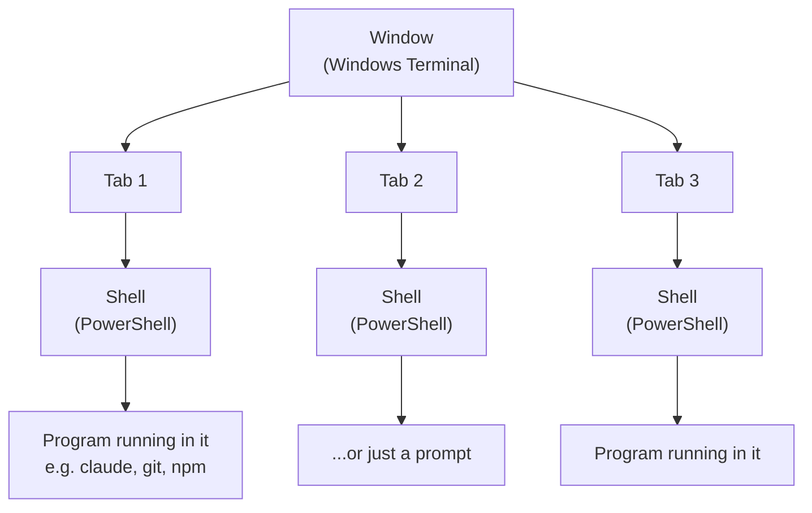
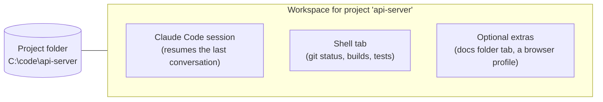
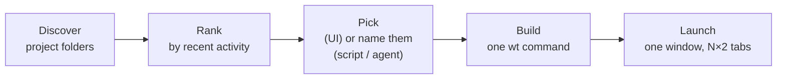
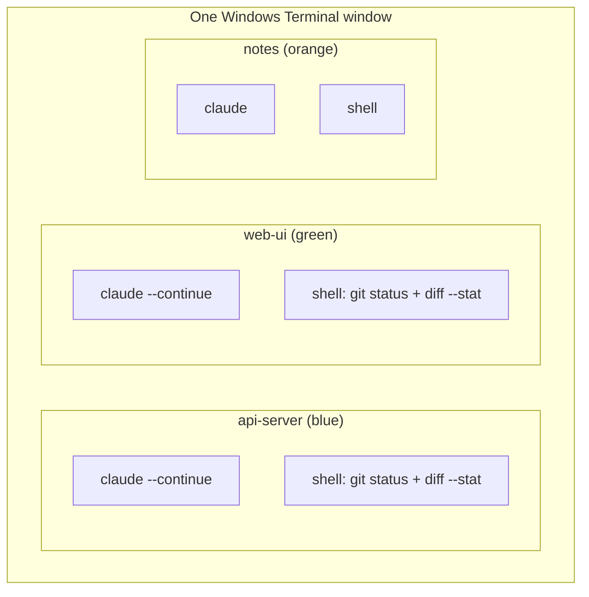
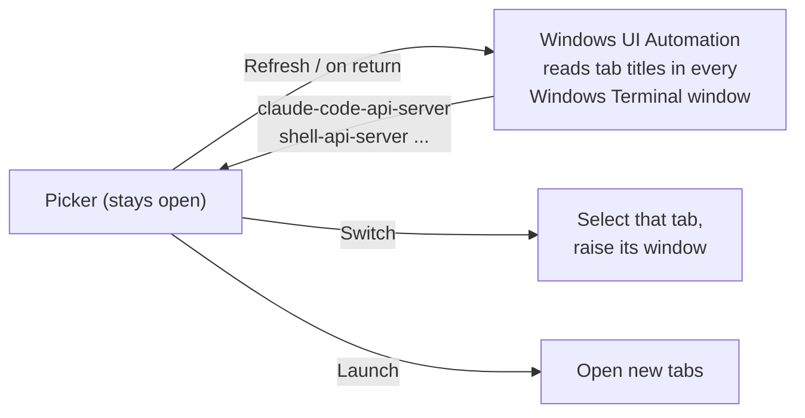
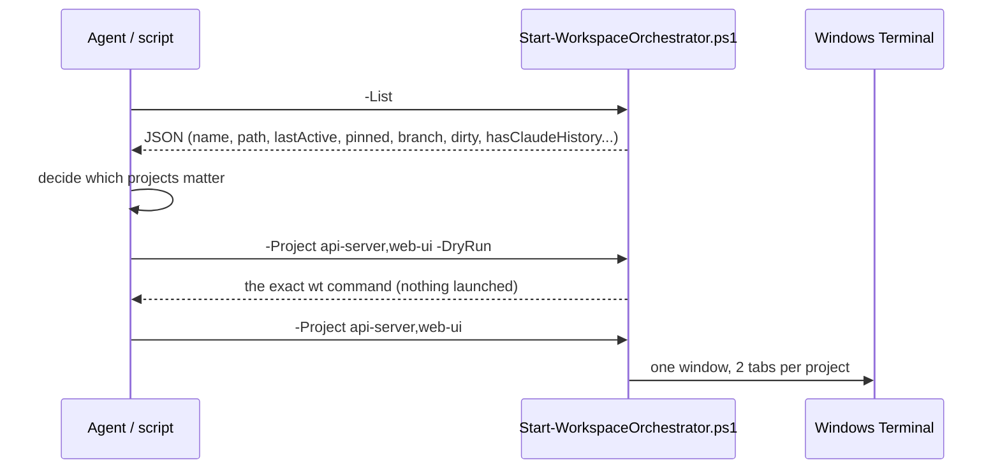
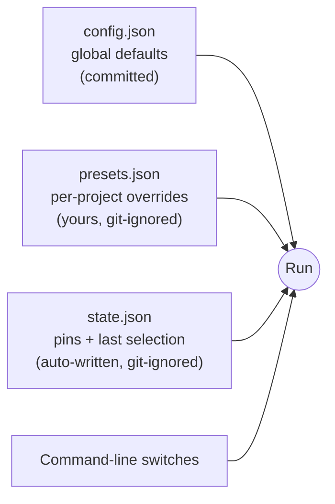

# Workspace Orchestrator

> **Status: experimental (v0.1).** Windows only. Works on my machine; expect rough edges. Issues and ideas welcome.

One click, and every project you're actively working on is open in **one Windows Terminal window**: a [Claude Code](https://claude.com/claude-code) session and a PowerShell prompt per project, each already in the right folder, each color-coded.

If you juggle several repos and keep re-opening terminals, `cd`-ing around, and typing `claude --continue`, this removes that ritual.

---

## Concepts

### Terminals

Four words that get mixed up:



- **Terminal (emulator):** the app that draws text and takes keystrokes. Here, Windows Terminal (`wt.exe`).
- **Tab:** one independent session inside a terminal window.
- **Shell:** the command interpreter inside a tab (PowerShell here). It has a **current directory**, which is what makes "which project am I in?" a real thing.
- **Program:** whatever the shell is running, such as Claude Code.

### Workspaces

A **workspace** is everything you need open to work on one thing. For a software project that is typically:



Building one by hand means: open a terminal, `cd`, run `claude --continue`, open a second tab, `cd` again, run `git status`. Times the number of projects. Every day.

### Workspace orchestration

**Orchestration** is automating that setup: *decide which projects matter, then assemble all their workspaces in one go.*



What you get after picking, say, three projects:



---

## What's in it for you

| You want to... | Use |
|---|---|
| Start the day with your active repos open | Double-click the **Workspace Picker** desktop shortcut |
| See what you touched last | Picker sorts by last git commit (or newest file) |
| Keep favorites at the top | **Pin** in the picker |
| Re-open yesterday's set | Last selection is pre-checked |
| Find an already-open workspace among many terminal windows | Keep the picker open; **Switch** raises the right tab and window |
| Know at a glance which repo has uncommitted work | Branch + dirty/clean columns; shell tab shows `git status` and a diff summary on open |
| Tell projects apart in the tab strip | Stable per-project tab colors |
| Resume a Claude conversation automatically | `--continue` is used only when a prior session exists |
| Add project-specific tabs/apps | `presets.json` |
| Let an AI agent or a script open workspaces | **Agent mode** (below) |

---

## Requirements

- Windows 10/11 with **Windows Terminal** (`wt.exe`)
- **Windows PowerShell 5.1** (`powershell.exe`, built in)
- [Claude Code](https://claude.com/claude-code) CLI on your `PATH` (`claude`)
- `git` (optional; enables commit-time ranking, branch/dirty info, and the diff summary)

## Quick start

```powershell
git clone https://github.com/dstaulcu/workspace-orchestrator.git
cd workspace-orchestrator

# 1. Try it
powershell.exe -NoProfile -ExecutionPolicy Bypass -File .\Start-WorkspaceOrchestrator.ps1

# 2. Optionally create a Desktop shortcut called "Workspace Picker"
powershell.exe -NoProfile -ExecutionPolicy Bypass -File .\Install-Shortcut.ps1
```

By default it treats each immediate subfolder of `C:\code` as a project. Change `root` in `config.json` (or pass `-Root D:\src`).

## Using the picker

Check the projects you want, press **Launch** (or Enter). Type in the filter box to narrow the list. Select a row and click **Pin / Unpin** to keep it at the top. **Fresh sessions** starts plain `claude` instead of `claude --continue`. Close launches nothing.

### Stay open and jump between workspaces

The picker stays open after launching (untick **Keep open after launch**, or set `keepOpen: false`, for the old close-on-launch behavior). Projects that already have tabs open in any Windows Terminal window show a ● and a green row. Highlight one and click **Switch** to select its tab and bring its window to the front. That's the answer to "I have a sea of terminals and can't find the right one."



This works because every tab has a predictable title: `claude-code-<project>` for the Claude tab and `shell-<scope>` for the others. If you rename a tab or a program overrides its title, that tab won't be found.

Prefer a plain list? `-Picker Grid` uses PowerShell's `Out-GridView`.

## Agent mode (no UI)

Orchestration works for AI agents and scripts too. Nothing in this mode opens a dialog.



```powershell
$s = '.\Start-WorkspaceOrchestrator.ps1'
powershell.exe -NoProfile -File $s -List -Top 5          # discover
powershell.exe -NoProfile -File $s -Project a,b -DryRun  # preview
powershell.exe -NoProfile -File $s -Project a,b          # launch
powershell.exe -NoProfile -File $s -All -Top 3           # launch the 3 most recent
powershell.exe -NoProfile -File $s -Focus a              # bring project a's open tab to the front
```

`-List` includes a `running` flag per project. `-Focus` exits `1` if the project has no open tab, so an agent can do "focus it if open, otherwise launch it".

Exit code is `1` when none of the requested projects exist.

## Options

| Switch | Meaning |
|---|---|
| `-Root <path>` | Folder whose subfolders are projects |
| `-Top N` | Limit the list to the N most recent (with `-All`: how many to launch, default 15) |
| `-Filter <text>` | Pre-filter by name or path |
| `-Project a,b` | Launch these (name or full path), no picker |
| `-All` | Launch the top N, no picker |
| `-List` | Print project metadata as JSON and exit |
| `-Picker Forms\|Grid` | Picker style |
| `-Fresh` | Plain `claude`, ignore session history |
| `-NoShell` / `-NoDiff` / `-NoColor` | Drop the shell tab / the git summary / tab colors |
| `-Focus <name>` | Bring an open project's tab and window to the foreground (no UI) |
| `-Window <id>` | Add tabs to an existing Windows Terminal window (e.g. `0`) |
| `-DryRun` | Print the `wt` arguments instead of launching |

## Configuration

Three small files, each with one job:



Precedence: command-line switch > per-project preset > `config.json`.

**`config.json`**: `root`, `top`, `ignore`, `noiseDirs`, `maxScanFiles`, `maxScanDepth`, `picker`, `shell`, `diff`, `tabColors`, `gitInfo`, `claudeArgs`, `keepOpen`.

**`presets.json`**: copy [`presets.example.json`](presets.example.json). Per project (matched by folder name): `extraTabs` (`title` + `path`), `launch` (`exe` + `args`, extra apps), `claudeArgs`, `shell`, `diff`, `tabColor`.

## How it avoids the classic Windows Terminal traps

Building a multi-tab `wt` command line is fiddly. The script encodes these lessons so you don't have to relearn them:

- `wt` treats `;` as a command separator **even inside quotes**; a `;` within a tab's command is written `\;`, otherwise you get a bogus extra tab.
- The whole thing is **one** argument string passed verbatim to `wt`, not an array.
- `-d <dir>` alone doesn't reliably set the directory, so each tab also runs `Set-Location -LiteralPath`.
- Paths with spaces are quoted differently for `wt` (double quotes) and inside the PowerShell command (single quotes).

## Safety

Launching never modifies your projects. The only file it writes is its own `state.json`. No network access, no credentials.

## Design docs

The project is described Kiro-style (requirements → design → tasks) in [`.kiro/specs/`](.kiro/specs/):

1. [Project discovery and launch](.kiro/specs/01-discovery-and-launch/)
2. [Interactive picker](.kiro/specs/02-interactive-picker/)
3. [Configuration, presets and agent mode](.kiro/specs/03-config-presets-agent-mode/)

## Roadmap ideas

macOS/Linux terminals (tmux, iTerm), other agent CLIs, saved named "sets" of projects, a per-project startup command, a test suite.

## License

[MIT](LICENSE)
