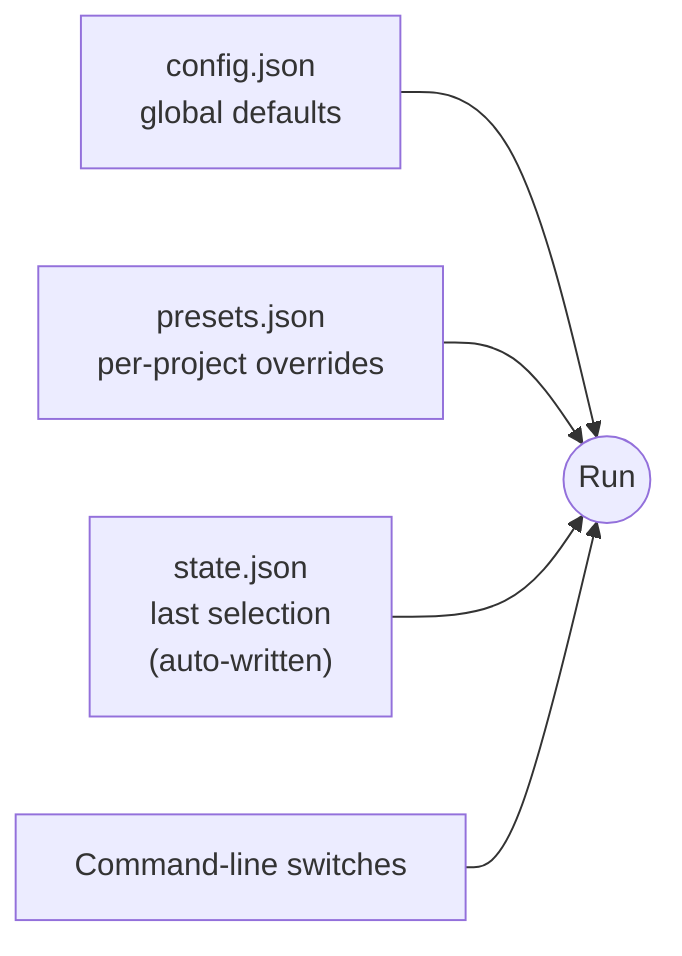

# Configuration reference

Three small files, each with one job:

Precedence: command-line switch > per-project preset > `config.json`.

All three files live in `~\.config\workspace_app\` (outside the repo, so updates never touch them; files from older versions next to the script are moved there on first run). Open `config.json` or `presets.json` from the picker with the **Settings** button, which creates them from [`config.example.json`](../config.example.json) / [`presets.example.json`](../presets.example.json) if missing. Changes apply the next time the picker starts. Both files have JSON schemas ([`config.schema.json`](../config.schema.json), [`presets.schema.json`](../presets.schema.json)) (`config.example.json` already references its schema; for `presets.json` map `presets.schema.json` in your editor's JSON settings) so editors like VS Code give hover help and validation. To use a different settings folder (a portable setup, or the demo workspace from `tools/New-DemoWorkspace.ps1`), set the `WORKSPACE_APP_CONFIG` environment variable to its path before starting the picker.

## `config.json`

| Key | Type | Default | Meaning | Override |
|---|---|---|---|---|
| `roots` | string[] | `[]` | Folders whose subfolders are the projects; several can be used at once and are merged into one list. Takes precedence over `root`. Set from the first-run dialog or **Settings > Projects folders...** (which also writes `root`). If a project folder name appears in more than one folder, the later ones are shown as `name (parentfolder)`. | `-Root a,b` |
| `root` | string | `C:\code` | The single projects folder, used when `roots` is empty (older configs keep working). | `-Root` |
| `projects` | string[] | `[]` | Individual folders that are projects themselves (not parents of projects), added to the list in addition to `roots`; handy for a one-off project in another place. Ignored when `-Root` is given. | |
| `showCost` | bool | unset | Show the Cost column: each project's estimated API-equivalent Claude Code cost, computed from Claude Code's session files under `~\.claude\projects` (read-only; token counts kept in `costs.json`). Unset = the picker asks once; **Settings > Show project cost** sets it. Adds `costUsd` to `-List` when true. Prices: `assets/model-prices.json`, override in `~\.config\workspace_app\model-prices.json`. | |
| `top` | int | `0` | Show only the N most recent; `0` = all (with `-All`: how many to launch, `0` = 15) | `-Top` |
| `ignore` | string[] | `[]` | Folder names to skip | `-Ignore` |
| `noiseDirs` | string[] | `.git`, `node_modules`, `.venv`, ... | Directories skipped when scanning a non-git project for its newest file | none |
| `maxScanFiles` | int | `5000` | Max files examined per non-git project | none |
| `maxScanDepth` | int | `6` | Max folder depth of that scan | none |
| `picker` | `Forms` \| `Grid` | `Forms` | Picker UI | `-Picker` |
| `shell` | bool | `true` | Open a shell tab per project | `-NoShell`, preset |
| `diff` | bool | `true` | Run `git status -sb; git diff --stat` in git shell tabs | `-NoDiff`, preset |
| `tabColors` | bool | `true` | Color tabs by project name | `-NoColor`, preset `tabColor` |
| `gitInfo` | bool | `true` | Show branch / state / remote columns | none |
| `checkForUpdates` | bool | `true` | Look for a newer GitHub release on startup and offer to update | none |
| `updateCheckHours` | number | `24` | Minimum hours between automatic update checks | Settings > Check for updates now |
| `updateRepo` | string | `dstaulcu/workspace-wrangler` | GitHub `owner/repo` whose releases are checked (for forks) | none |
| `arrangeOnLaunch` | bool | `true` | After launching 2+ projects, arrange the new windows on the primary screen | none |
| `keepDesktopIconsClear` | bool | `true` | Arranged windows start at desktop-icon row 2, column 2 (first column/row of desktop icons stay visible) | none |
| `windowWidth` / `windowHeight` | int | `1100` / `750` | Default window size in pixels for Cascade and Reset window size (clamped to the screen) | none |
| `arrangeStyle` | `cascade` \| `grid` \| `columns` \| `rows` | `cascade` | How windows are arranged (overlapping cascade, grid, side by side, stacked) | Arrange menu |
| `restoreLayouts` | bool | `true` | Put each project's new window where you last saved it (**Settings > Save window layout**; stored per monitor setup in `layouts.json`) | none |
| `gitOpsOrg` | string | `""` | Organization pre-filled as owner in **Git > Create remote repository on GitHub** (blank = your own account) | dialog |
| `gitOpsTargets` | array | `[]` | Entries for the **Git > Create remote repository** submenus: a string = GitHub organization, or `{ "provider": "gitlab", "owner": "group/sub", "host": "gitlab.example.com" }` (`github`, `gitlab` or `azure`; Azure owner = `org/project`) | submenu |
| `gitOpsVisibility` | `private` \| `internal` \| `public` | `private` | Visibility pre-selected in that dialog | dialog |
| `refreshSeconds` | int | `60` | While the picker is open, re-check which projects have tabs open every N seconds (min 5; `0` = off) | none |
| `git` | string | `git` | git to use: a command on PATH, or the full path to `git.exe` (portable installs) | all git calls |
| `hotkey` | string | `Ctrl+Alt+W` | Global hotkey while the picker is open: cascade all open workspace windows to the front (needs a modifier; empty = off) | none |
| `claudeVariants` | `{name, args}[]` | `[]` | Extra entries under right-click > Launch > Claude session; each starts Claude + shell with these arguments added (no double quotes), e.g. `{ "name": "Plan mode", "args": "--permission-mode plan" }` | menu |
| `ide` | string | `code` | Command the **IDE** button runs (VS Code by default; e.g. `cursor`, or a full path) | button |
| `ideArgs` | string | `-n` | Arguments before the folder (`-n` = new window per project) | button |
| `claudeArgs` | string | `""` | Extra `claude` arguments (no double quotes) | preset |

## `presets.json`

See [`presets.example.json`](../presets.example.json). An array of objects matched to projects by folder `name`; every other key is optional.

| Key | Type | Meaning |
|---|---|---|
| `name` | string | Project folder name (required) |
| `extraTabs` | `{title, path}[]` | Additional shell tabs in other folders |
| `launch` | `{exe, args[]}[]` | Extra apps started with the project |
| `claudeArgs` | string | Replaces the global `claudeArgs` for this project |
| `startupCommand` | string | Runs in the project's shell tab on launch (e.g. `npm run dev`) instead of the git summary; no double quotes |
| `urls` | string[] | http(s) addresses opened in your default browser each time the project is launched (not when an already-open project is just raised) |
| `shell`, `diff` | bool | Override the global setting for this project |
| `tabColor` | `#RRGGBB` | Fixed tab color |
