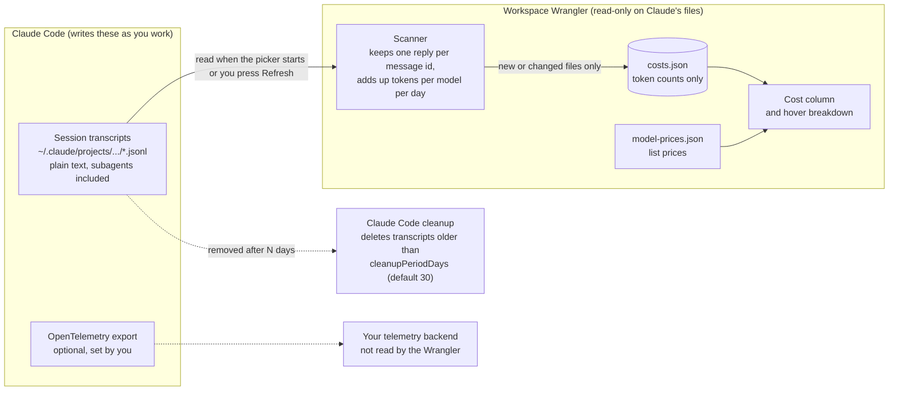
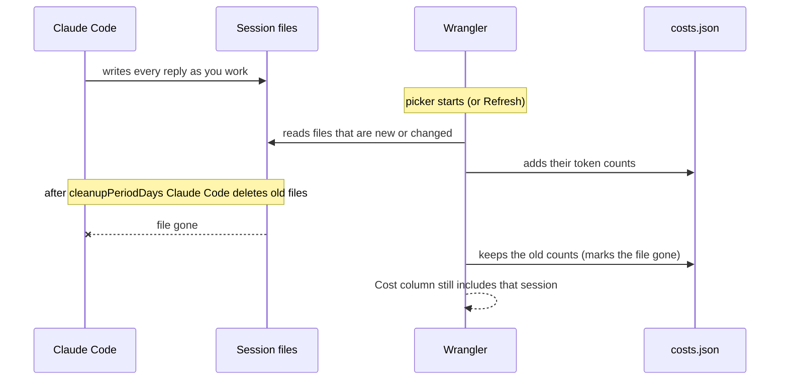

# Where the cost data comes from, and what is kept

This page explains how Workspace Wrangler's optional **Cost** column gets its numbers, what it stores, and what that means for how long Claude Code needs to keep its raw session files.

**Short version:** the Wrangler reads Claude Code's local session files (not its telemetry), boils them down to small per-day token counts in its own ledger, and works out dollars from those counts. Once a session's counts are in the ledger, the raw file is no longer needed for cost.

## The data flow

Solid arrows are what the Wrangler does. Dotted arrows are things that happen outside it.

## What is read, what is kept, what is dropped

| Stage | What it holds | Where |
|---|---|---|
| **Raw transcript** (Claude Code's) | Every prompt, reply, tool call and tool output, as plain text, plus per-reply token usage | `~\.claude\projects\<project>\<session>.jsonl` and `<session>\subagents\` |
| **Ledger** (the Wrangler's) | Per transcript file: session id, project folder key, first and last timestamp, and token counts per **day** per **model** (input, output, cache read, cache write 5 min and 1 hour, web searches, fast mode) | `~\.config\workspace_app\costs.json` |
| **Dollars** | Not stored. Computed when shown from the ledger's counts and the price table, so updating prices re-prices all history | in memory |

Dropped on the way into the ledger: all prompt and reply text, tool inputs and outputs, file paths, code. Nothing leaves your computer.

## When the scan happens

The important consequence: **the ledger only knows about sessions the Wrangler has seen.** A session that is created and then deleted by Claude Code's cleanup before you next open the picker is never counted. With the default 30-day cleanup, opening the picker at least once a month is enough.

## What this means for retention

`cleanupPeriodDays` in Claude Code's `settings.json` decides how long the raw files live. Whether you need it long depends on what you use them for:

| You want | Raw files needed? | Suggested retention |
|---|---|---|
| **Cost per project** (this feature) | Only until the Wrangler has scanned them once | The default 30 days is fine if you open the picker at least that often. Longer is a safety margin. |
| **Resuming old conversations** (`claude --resume`, `--continue`) | Yes, the transcript is the conversation | As long as you want to be able to go back |
| **Reviewing how you work** (what you asked, which tools and features you used), a possible future Wrangler feature | Yes, today nothing aggregates this | Long (for example 3650 days), until such facts are aggregated like cost is |
| **Fewer plain-text secrets lying around** (transcripts include anything a tool printed, such as `.env` contents) | The opposite: shorter is safer | Short |

So your instinct is right for cost: an aggregate is enough, and that is why the ledger exists. The same idea would let usage reviews work with short raw retention too: record small per-day facts (tool counts, slash commands, subagent use, models) when a session is first seen, then let the raw file expire. That aggregation does not exist yet.

## What the Wrangler does not touch

- **Telemetry.** Claude Code's OpenTelemetry export (if you turned it on) goes to the endpoint you configured. The Wrangler never reads it, changes it or sends anything to it. The **Claude Code data health** dialog only reports whether it is on, by variable name.
- **Claude's files.** They are opened read-only. The single exception is the optional, confirmed change of `cleanupPeriodDays` in `settings.json` (with a `.bak` backup).
