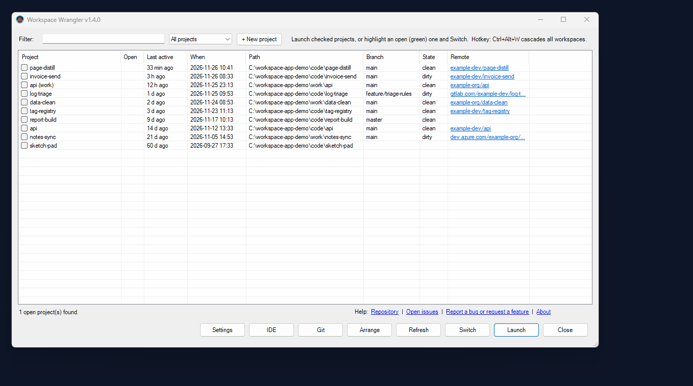
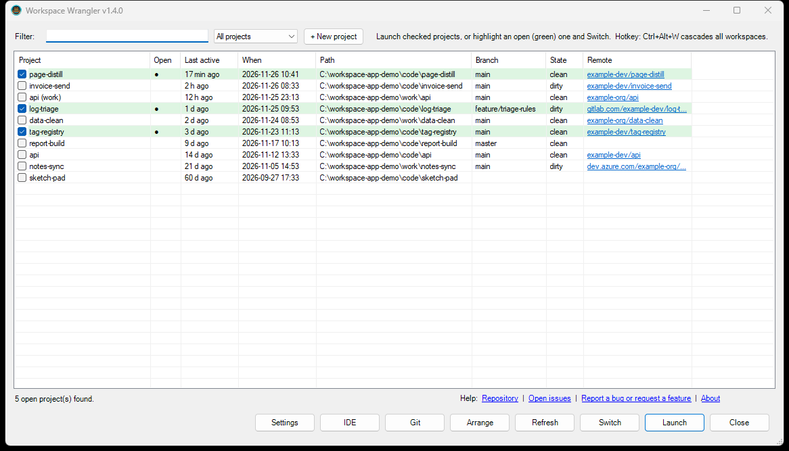
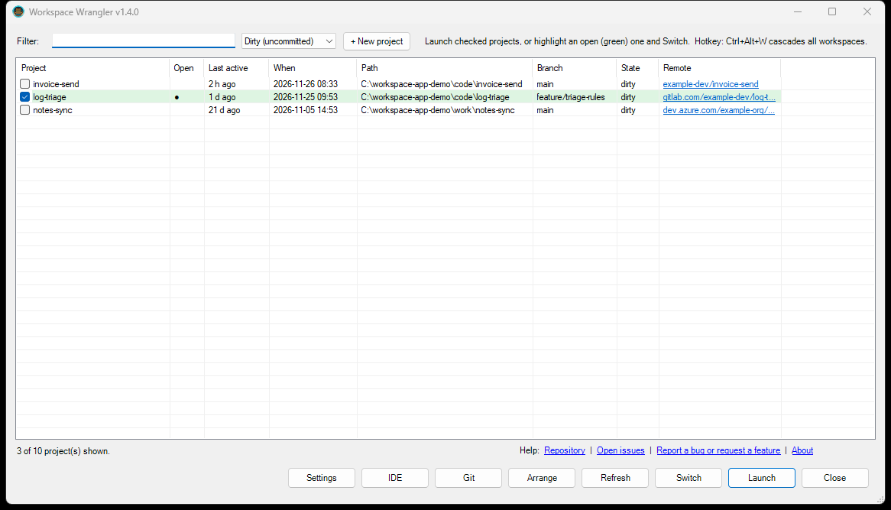
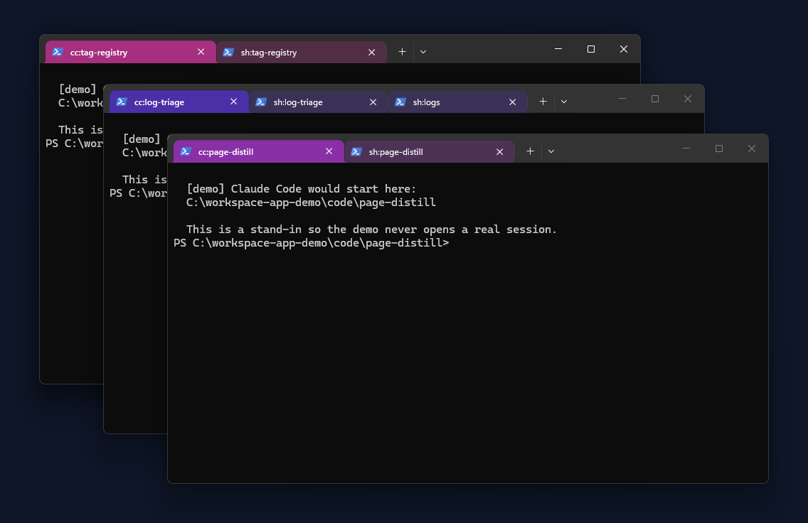
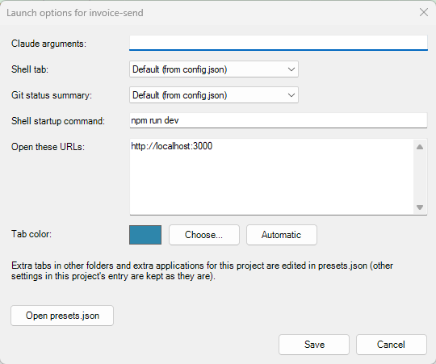
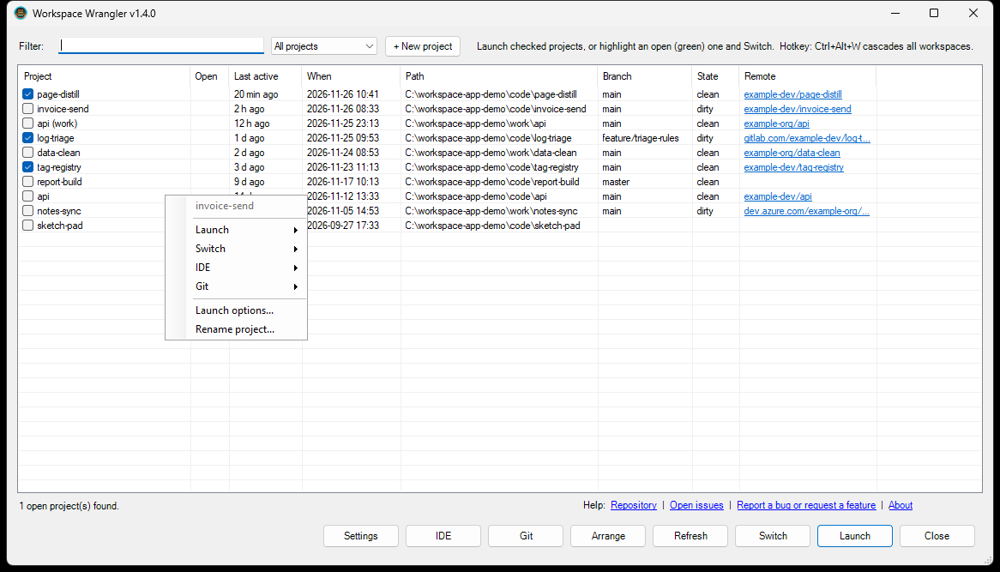
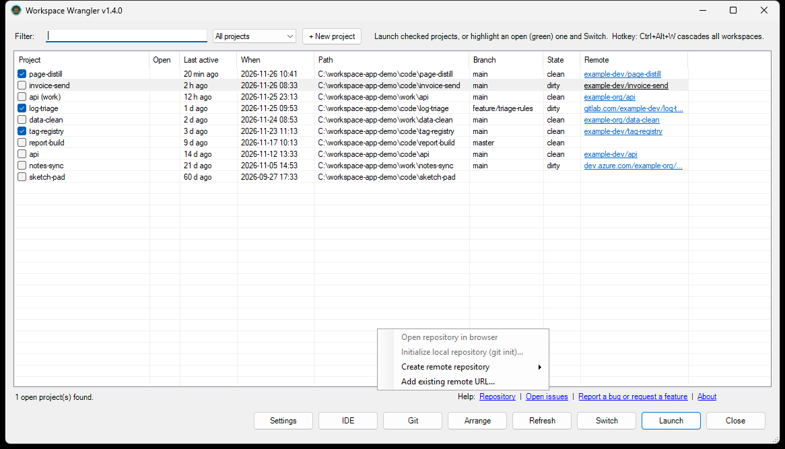
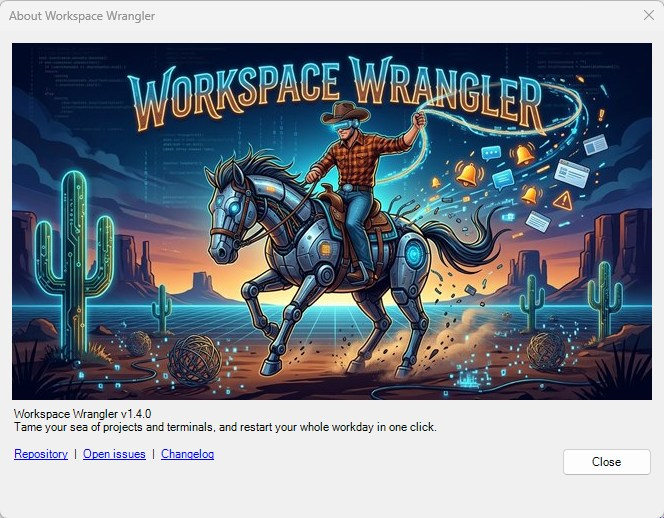

# A quick tour

Everything below was captured from the built-in demo workspace (fake projects, fake remotes, fake author), so nothing here is anyone's real work. Try the same thing yourself:

```powershell
.\tools\New-DemoWorkspace.ps1 -Launch     # builds C:\workspace-app-demo and opens the picker on it
.\tools\New-DemoWorkspace.ps1 -Remove     # deletes it again
```

The demo uses its own settings folder (through the `WORKSPACE_APP_CONFIG` environment variable) and a stand-in for `claude`, so your real settings are untouched and no real Claude session starts. Pass `-RealClaude` to run your real `claude` in the demo windows.

## The whole flow in 20 seconds



Recorded with ScreenToGif from the demo workspace. Regenerate it by running the demo (`-Launch`) and recording the picker yourself; the picker stays still between steps, which is why the GIF is small.

## 1. All your projects, newest first, with what is open



Projects from every folder you chose are merged into one list. Green rows with a dot already have `cc:` and `sh:` tabs open in Windows Terminal; **Launch** brings those forward instead of opening duplicates. The two `api` projects live in different folders, so the second one is labelled `api (work)`.

## 2. Find uncommitted work in one click



The state dropdown narrows the list to dirty, clean, open, not-open or non-git projects. Click any column header to sort.

## 3. One window per project, color-coded, side by side



Each project gets its own Windows Terminal window with a Claude Code tab and a shell tab, colored by project. **Ctrl+Alt+W** (or **Arrange**) cascades every open workspace so you can see all of them. Here the Claude tabs show the demo stand-in banner.

## 4. Per-project launch options



Right-click a project and choose **Launch options...** to set Claude arguments, the shell startup command (here `npm run dev`), URLs to open in your browser, and a tab color. Extra tabs and apps stay in `presets.json`.

## 5. Everything one right-click away



Launch variations (Claude only, shell only, resume a session), Switch to a specific tab, open in your IDE, git actions, per-project launch options, and Rename project (which carries Claude's history along).

## 6. Git, including creating the remote



For a repository without a remote, **Create remote repository** offers GitHub, GitLab and Azure DevOps targets you configure; **Add existing remote URL...** wires up an existing one.

## 7. About


